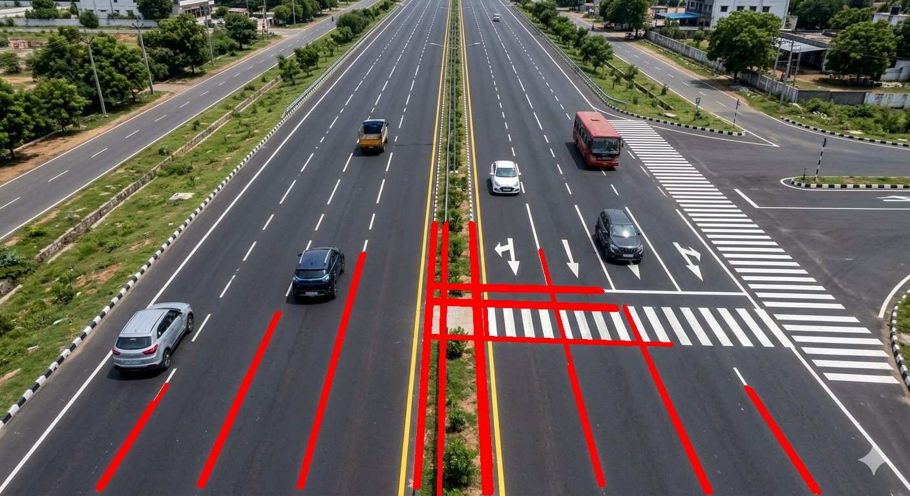

# Classical Computer Vision: Lane Line Extractor

## Overview

This project implements a basic lane line detection pipeline using **Python and OpenCV**. It processes a static road image to identify road markings and edges, restrict the analysis to a selected region of interest, and highlight detected line segments in red.

The project demonstrates fundamental classical computer vision techniques without using machine learning or deep learning models.

## Technologies Used

- **Python** — programming language
- **OpenCV** — image processing and computer vision
- **NumPy** — numerical operations and array manipulation

## Computer Vision Pipeline

The project uses the following steps:

1. **Image Loading:** Loads a static road image using OpenCV.
2. **BGR to HSV Conversion:** Converts the image from BGR colour format to HSV (Hue, Saturation, Value), which can make colour-based filtering easier.
3. **HSV Colour Filtering:** Creates a mask to identify bright, low-saturation regions, such as white road markings.
4. **Gaussian Blur:** Reduces small image irregularities and noise before edge detection.
5. **Canny Edge Detection:** Identifies strong intensity changes and produces an edge map.
6. **Region of Interest (ROI) Masking:** Restricts the detected edges to a selected polygonal region of the road.
7. **Hough Line Transform:** Detects line segments from the edges that remain after ROI masking.
8. **Line Visualization:** Draws the detected line segments in red on the original image.
9. **Output Saving:** Saves the intermediate processing results and the final visualization.

## Project Structure

```text
task2/
├── images/
│   └── road1.jpg
├── outputs/
│   ├── road1_hsv_mask.jpg
│   ├── road1_blurred.jpg
│   ├── road1_edges.jpg
│   ├── road1_roi.jpg
│   └── road1_lane_lines.jpg
├── lane_detector.py
├── requirements.txt
├── README.md
└── .gitignore
```

The `.venv/` directory contains the local Python virtual environment and is excluded from version control.

## Results

### Final Lane Line Detection

The detected line segments are drawn in red on the original road image.



### Intermediate Outputs

The program also saves intermediate images to the `outputs/` directory:

- `road1_hsv_mask.jpg` — result of HSV colour filtering.
- `road1_blurred.jpg` — image after Gaussian blur.
- `road1_edges.jpg` — edges detected using Canny.
- `road1_roi.jpg` — edges retained within the region of interest.
- `road1_lane_lines.jpg` — final image with detected line segments overlaid in red.

## Installation and Usage

### 1. Clone the repository

```bash
git clone <YOUR_GITHUB_REPOSITORY_URL>
cd task2
```

Replace `<YOUR_GITHUB_REPOSITORY_URL>` with the URL of your repository.

### 2. Create and activate a virtual environment

```bash
python3 -m venv .venv
source .venv/bin/activate
```

### 3. Install the dependencies

```bash
pip install -r requirements.txt
```

### 4. Run the program

Ensure that `images/road1.jpg` exists, then run:

```bash
python lane_detector.py
```

The program processes the image and saves the results in the `outputs/` directory.

## Limitations

- The pipeline is designed for static images rather than real-time video.
- HSV colour thresholds may need adjustment for different lighting conditions and road colours.
- Canny and Hough transforms detect prominent edges and line segments, not exclusively lane boundaries. Consequently, pedestrian crossings and other road markings may also be detected.
- The region of interest is defined using fixed proportions of the image dimensions and may need adjustment for other camera angles.

## Future Improvements

- Improve filtering to distinguish lane boundaries from other road markings.
- Tune the HSV thresholds and Hough transform parameters for different road conditions.
- Test the pipeline on multiple road images.
- Extend the implementation to process video frames.

## Acknowledgements

The sample road image was generated using Google Gemini for demonstration purposes.